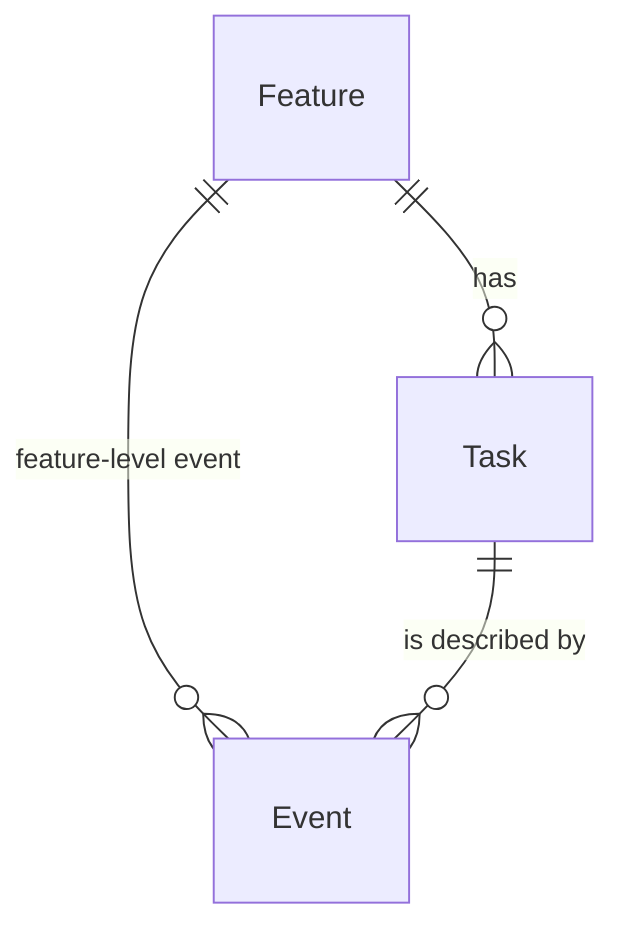

# Event log and stats (RFC 0001)

## Problem

The CLI records where a task is, not how it got there. A task file holds `status`, `attempts`,
`base_commit` and, once done, `branch` and `commit`. Verification evidence has a timestamp, but it
lives under `.git/office-verification`, is overwritten on every `claim`, `retry` and `block`, and
never leaves the machine. So wall-clock time, first-pass check rate, retries per task (only the
final count survives, with no order or reasons) and escalation rate cannot be computed, and
roadmap phases 2 to 4 all read those numbers. Separately, nothing in `config.yml` describes the
layout of the board, so an older CLI cannot tell that it is writing to a board it does not
understand. The RFC gives no figures; the cost is that every later phase is blocked.

When this ships, running a feature end to end leaves an ordered record in
`.the-office/events.jsonl`, `office stats --json` prints the four metrics with no model involved,
and a board declares `schema: 1`.

## Flow

Reuses the existing `execution.lock` for write ordering, the existing `isBoardState` exclusion that
already keeps `findings.jsonl` out of scope and snapshots, and the `findings.jsonl` append pattern;
no second locking or serialisation mechanism is added.

1. any command -> dispatcher in `payload/bin/office.mjs` (exists) - reads `schema` from
   `config.yml`; refuses when it is newer than the CLI's `SCHEMA` (door 3); takes
   `execution.lock` as today
2. lifecycle/verification handler in `payload/bin/office.mjs` (exists) - makes the state change
   durable (`changeStatus` rename, `saveEvidence`), then appends one line to
   `.the-office/events.jsonl` (door 1); a failing `check`/`scope` appends before exiting 1
3. `isBoardState` in `payload/bin/office.mjs` (exists) - excludes `events.jsonl` from the
   dirty-tree check, scope and the verification snapshot
4. `office stats` in `payload/bin/office.mjs` (exists, new command) - reads the log and the board,
   writes nothing, takes no lock; out: table or one JSON object (door 2)
5. `office validate` in `payload/bin/office.mjs` (exists) - additionally parses every log line,
   checks each task's event sequence, reports board and CLI schema
6. `office init` in `payload/bin/office.mjs` (exists) - writes `schema: 1`, an empty
   `events.jsonl`, and the union-merge line in `.gitattributes` (door 4)

## Impact

| Front | What changes |
| --- | --- |
| domain | new term: `event` - one line of `events.jsonl`, a verdict or state change the CLI observed; lives in `office.mjs` |
| domain | new term: `schema` (board schema) - integer describing the layout of `.the-office/`; distinct from `version`, which stays "installed version at init time" and nobody branches on |
| domain | existing term: board state (`isBoardState`) meant features/, `findings.jsonl`, the lock; now also `events.jsonl` - `changedFiles` (scope, `requireClean`) and `snapshot` branch on it, so edits to the log are invisible to scope and never stale evidence |
| stored data | nothing to migrate: a config with no `schema` is schema 0 and is treated like 1; tasks with no events are excluded from every rate and counted |
| target repos | `office init` appends one line to `.gitattributes` (creating it if absent); an existing file is otherwise untouched |
| templates | `templates/config.yml.tmpl` gains `schema: 1` and the `# Populated by` comment the inline config already has, so the two become identical |
| board-ui | nothing: `board.rs` reads only `.the-office/features/` |
| release | a `feat:` commit touching `payload/` and `templates/` publishes a minor release when merged to `main` |
| docs | RFC 0001 status and the `docs/rfcs/README.md` row become `Implemented`; open questions answered in the RFC text |

## Relations

One-way constraints: line order is event order and there is no sequence number (door 1); the log
is append-only and committed (door 1). No columns and no types here.

## Surface

HTTP routes: none - the surface is CLI commands, so the "statuses" are exit codes. Each command
below owes a `Coverage` set row in `checks.md` whose members are its exit codes.

- `office stats [feature] [--json]` (new) - in: optional feature slug, `--json`; out: a table, or
  one JSON object `{metrics, excluded}` (door 2); exit `0`, or `1` (no board; board schema
  refused)
- `office validate` (changed) - out: adds a `board schema N, CLI schema M` line and event-log
  errors; exit `0`, or `1` (any error)
- `office init [--force]` (changed) - additionally writes `schema: 1`, `events.jsonl` and the
  `.gitattributes` line; exit `0`, or `1` (board exists without `--force`; board schema refused)
- every command except `help` and `version` (changed) - in: a board whose `schema` is greater than
  the CLI's `SCHEMA`, or not a non-negative integer; out: message on stderr; exit `1`

## Landing

| One-way door | Literal shape | Alternative rejected |
| --- | --- | --- |
| 1. Event line format, committed | `{"v":1,"at":"2026-11-25T12:00:00.000Z","event":"claim","task":"sample/task-01","feature":"sample","outcome":"ok","attempt":1,"base_commit":"<sha>"}` in `.the-office/events.jsonl`; events `feature` `claim` `check` `scope` `review` `retry` `done` `block`; extra fields per the RFC table; `scope.files` and `scope.outside` are counts | a `seq` field - redundant with line order and duplicated by a union merge; a log under `.git/` - does not survive a clone, CI cannot read it |
| 2. `stats --json` keys | `{"metrics":{"cycle_time_ms":{"n":2,"median":90000,"p90":120000},"lead_time_ms":{"<feature>":300000},"first_pass_check_rate":{"passed":1,"tasks":2,"rate":0.5},"retries_per_task":{"retries":2,"tasks":2,"mean":1,"max":2},"escalation_rate":{"escalated":1,"tasks":2,"rate":0.5}},"excluded":1}`; empty denominators give `null` for `median`, `p90`, `rate`, `mean` and `0` for `max` | bare ratios with no numerator/denominator - Phase 3 cannot aggregate rates across runs without the counts |
| 3. Board schema key | `schema: 1` in `config.yml`; `const SCHEMA = 1` in `office.mjs`; absent means `0` | reusing `version` - it is the installed version at init time and would refuse every board initialised by a newer patch release |
| 4. Union merge for board logs | `.the-office/*.jsonl merge=union` in `.gitattributes` | no merge driver - two branches that both append conflict on every merge; forced by the log being committed (RFC "Committed, like the ledger") |

- Nothing else in this change is hard to reverse

## Criteria

### S1: lifecycle commands leave an ordered event log (P1)

Driving one task through its lifecycle produces one line per verdict or state change.

**Acceptance Criteria**

1. The CLI SHALL write every event as one JSON object on one line of `.the-office/events.jsonl` with `v` equal to `1`, `at` an ISO 8601 UTC timestamp, `event`, `feature` and `outcome`, and `task` equal to the task id on every event except `feature`.
2. WHEN `office claim` moves a task to `in-progress` THEN the CLI SHALL append a `claim` event with `outcome: "ok"`, `attempt` equal to the new `attempts` value and `base_commit` equal to the task's recorded base.
3. WHEN `office check` runs every check with exit 0 and records evidence THEN the CLI SHALL append a `check` event with `outcome: "ok"` and an integer `duration_ms` >= 0.
4. IF a check command exits non-zero THEN the CLI SHALL append a `check` event with `outcome: "fail"`, `duration_ms`, `command` equal to the failing command and `exit` equal to its exit code, and then exit 1.
5. WHEN `office scope` finds every changed file inside the allowlist and records evidence THEN the CLI SHALL append a `scope` event with `outcome: "ok"` and `files` equal to the number of changed files.
6. IF `office scope` finds files outside the allowlist THEN the CLI SHALL append a `scope` event with `outcome: "fail"`, `files` equal to the number of changed files and `outside` equal to the number outside the allowlist, and then exit 1.
7. WHEN `office review` moves a task to `review` THEN the CLI SHALL append a `review` event with `outcome: "ok"`.
8. WHEN `office retry` moves a task back to `in-progress` THEN the CLI SHALL append a `retry` event with `outcome: "ok"`, `attempt` equal to the new `attempts` value and `reason` equal to the `--reason` text.
9. IF `office retry` runs at the attempt limit THEN the CLI SHALL append exactly one line, a `retry` event with `outcome: "exhausted"`, `attempt` equal to the unchanged `attempts` value and `reason`, and no `block` event.
10. WHEN `office done` moves a task to `completed` THEN the CLI SHALL append a `done` event with `outcome: "ok"` and `commit` and `branch` equal to the values written to the task file.
11. WHEN `office block` succeeds THEN the CLI SHALL append a `block` event with `outcome: "ok"`, `reason` and `from` equal to the status the task had before the command.
12. WHEN `office feature new` creates a feature THEN the CLI SHALL append a `feature` event with `outcome: "ok"`, `feature` equal to the slug, `type` equal to the spec type, and no `task` key.
13. IF a lifecycle or verification command exits on a precondition (wrong status, dirty tree, stale spec approval, lock held, missing `--reason`, invalid `checks` or `scope` list, unmet dependency, code or contract changed during the run) THEN the CLI SHALL leave `events.jsonl` byte-identical.
14. The CLI SHALL append at most one line to `events.jsonl` per command invocation.
15. WHILE `events.jsonl` has uncommitted appended lines, the CLI SHALL treat the working tree as clean and evidence as current, so `office review` exits 0 after `check` and `scope` have appended.

**Independent test:** in a temp repo, drive `sample/task-01` through claim, failing check, passing check, scope, review, retry, check, scope, review, done and read the log.

### S2: `office stats` derives the metrics from the log (P1)

A reader gets cycle time, lead time, first-pass check rate, retries per task and escalation rate.

**Acceptance Criteria**

16. WHEN `office stats --json` runs THEN the CLI SHALL print exactly one JSON object with the keys `metrics` and `excluded` and exit 0, writing no file and taking no lock.
17. The CLI SHALL report `cycle_time_ms` as `n`, `median` and `p90` over tasks that have a `done` event, each value being the `at` of `done` minus the `at` of the task's first `claim`, with `median` the mean of the two middle values when `n` is even and `p90` the nearest-rank value at `ceil(0.9 * n)`.
18. The CLI SHALL report `lead_time_ms` as a map from feature slug to the `at` of the feature's last `done` minus the `at` of its `feature` event, omitting any feature with no `feature` event or no `done` event.
19. The CLI SHALL report `first_pass_check_rate` as `passed` (tasks whose first `check` event is `ok`), `tasks` (tasks with at least one `check` event) and `rate` equal to `passed / tasks`.
20. The CLI SHALL report `retries_per_task` as `retries` (all `retry` events, including `exhausted`), `tasks` (tasks with a `claim` event), `mean` equal to `retries / tasks` and `max` equal to the largest per-task retry count.
21. The CLI SHALL report `escalation_rate` as `escalated` (tasks whose last event is `block` or a `retry` with `outcome: "exhausted"`), `tasks` (tasks with a `claim` event) and `rate` equal to `escalated / tasks`.
22. The CLI SHALL report `excluded` as the number of tasks on the board that have no event in the log.
23. WHERE a feature slug is given, the CLI SHALL compute every metric and `excluded` from only that feature's events and tasks.
24. IF a denominator is zero or the log is absent THEN the CLI SHALL print `null` for `median`, `p90`, `rate` and `mean`, `0` for every count and for `max`, and exit 0.
25. IF a log line is not valid JSON, or carries an `event` the CLI does not know, THEN `office stats` SHALL ignore that line.
26. WHEN `office stats` runs without `--json` THEN the CLI SHALL print one row per metric and a line stating how many tasks were excluded.
27. WHEN `office help` runs THEN the CLI SHALL list `stats [feature] [--json]`.

**Independent test:** `office stats --json` against a hand-written fixture log under `tests/fixtures/`, compared to checked-in expected values.

### S3: the board declares a schema the CLI respects (P1)

An older CLI refuses a newer board instead of writing to it.

**Acceptance Criteria**

28. WHEN `office init` writes `config.yml` THEN the CLI SHALL include the line `schema: 1`.
29. IF `config.yml` has a `schema` greater than the CLI's `SCHEMA` THEN every command except `help` and `version` SHALL exit 1 with a message naming both numbers and telling the user to upgrade the-office, changing no file.
30. IF `config.yml` has a `schema` that is not a non-negative integer THEN every command except `help` and `version` SHALL exit 1 naming the invalid value.
31. WHILE `config.yml` has no `schema` key, the CLI SHALL behave exactly as for `schema: 1`.
32. WHEN `office validate` runs THEN the CLI SHALL print the board schema and the CLI schema.
33. The inline config written by `office init` SHALL be byte-identical to `templates/config.yml.tmpl` after `{{VERSION}}` substitution.

**Independent test:** set `schema: 99` in a fixture board and run `office board`.

### S4: the log is validated and merges cleanly (P2)

`office validate` catches a malformed or illegal log; `init` prepares the files.

**Acceptance Criteria**

34. IF a non-empty line of `events.jsonl` is not a JSON object with a string `event` THEN `office validate` SHALL exit 1 naming the line number.
35. IF a task's known events, in line order, contain a transition outside this table THEN `office validate` SHALL exit 1 naming the line number, where a task's first event is legal from any state: `claim` from `blocked` to `in-progress`; `check` and `scope` in `in-progress` or `review`, state unchanged; `review` from `in-progress` to `review`; `retry` `ok` from `review` to `in-progress`; `retry` `exhausted` from `review` to `blocked`; `done` from `review` to `completed`; `block` from `in-progress`, `review` or `blocked` to `blocked`.
36. WHEN `office validate` meets a line whose `event` it does not know THEN the CLI SHALL skip that line without error.
37. WHEN `office init` runs THEN the CLI SHALL create an empty `.the-office/events.jsonl` if none exists and SHALL leave an existing one unchanged.
38. WHEN `office init` runs and `.gitattributes` at the board root has no line `.the-office/*.jsonl merge=union` THEN the CLI SHALL append that line, creating the file if absent, and SHALL NOT add it a second time.
39. WHEN `tests/run.sh` runs THEN it SHALL run `office validate` against this repository's own board and fail if it exits non-zero.
40. The file `payload/bin/office.mjs` SHALL import only `node:` modules.

**Independent test:** append `{"event":"done","task":"sample/task-01"}` after a `claim` line in a fixture log and run `office validate`.

## Out of scope

| Excluded | Why |
| --- | --- |
| `approve` event from `office spec approve` | RFC 0002 defines its fields (`gate`, `mode`, `by`, `hash`) together with the approval policy; writing it now freezes a shape without `mode` |
| event from `findings add` | the ledger already is the append-only record; a second copy creates two sources that can disagree |
| `office migrate` | RFC 0005 |
| logging refused commands | RFC rejects it: mixes operator errors into every rate |
| log rotation | RFC: none planned |
| fixing `findings.jsonl` `seq` under a union merge | existing weakness, noted in the RFC and not fixed there |
| showing events or schema in `board-ui` | RFC: it must tolerate them, not display them |

## Assumptions

| Assumption | Chosen default | Rationale | Confirmed? |
| --- | --- | --- | --- |
| RFC open question: should `office spec approve` log an event now? | No - deferred to RFC 0002 | its event shape there needs `gate` and `mode`, which do not exist yet; readers ignore unknown events, so adding it later is additive | y |
| RFC open question: should `findings add` emit an event? | No | the ledger is enough; one fact in two committed files can disagree | y |
| RFC status is `Draft`, and its README says implementation starts at `Accepted` | the request to implement is the acceptance; status goes straight to `Implemented` when the Verifier passes | the user asked for the implementation | y |
| a `check` whose commands pass but change code or contract | no event | it reaches no `ok`/`fail` verdict; the RFC's `fail` fields (`command`, `exit`) do not exist for it | y |
| `scope.files` type | a count, like `outside` | keeps lines short; the list is already in the evidence file | y |
| hand-editing a task's `status` after it has events | `office validate` reports an illegal sequence from then on | the RFC asks for a legal-sequence check; a log that disagrees with the board is what it is for | y |
| the append fails (disk, permissions) after the state change | the command exits 1 with the error; the state change is not rolled back | the task file is the source of truth; a sensor that drops data silently is worse than a loud failure | n |
| a log line with `v` other than `1` | read like any other line; unknown fields ignored | RFC: readers ignore unknown events and unknown fields | n |
| this repository's own board (`.the-office/config.yml`, no `schema`) | left at schema 0, no `.gitattributes` added here | schema 0 and 1 behave alike; migrating boards is RFC 0005 | n |
| profile | `light` (no declaration in the repo) | skill default | y |

**Open questions:** none - all resolved or logged above.

## Observable

| Surface | Decision | Landing |
| --- | --- | --- |
| command `office stats` | output format and verbosity | AC 16, AC 26 |
| command `office stats` | flags and defaults | AC 16, AC 23 |
| command `office stats` | exit codes | AC 16, AC 24, AC 29 |
| command `office stats` | fails halfway | n/a - read-only, there is no partial write to leave behind |
| the seven lifecycle commands and `feature new` | stdout and exit codes | existing - unchanged; the log is a side effect (AC 13 covers refusals) |
| the seven lifecycle commands and `feature new` | fails halfway | AC 4, AC 6 for verdicts; append failure is in Assumptions |
| command `office validate` | output and exit codes | AC 32, AC 34, AC 35 |
| command `office init` | what it writes, idempotence | AC 28, AC 37, AC 38 |
| every command, schema gate | exit code and message | AC 29, AC 30 |
| document `office help` | lists the new command | AC 27 |
| collection `events.jsonl` | ordering, duplicates, the line that does not fit | AC 1 (line order, door 1), AC 14, AC 25, AC 36 |

## Sources

- `docs/rfcs/0001-instrument.md` - event fields, rules, metric definitions, schema behaviour, test plan, exit criteria
- `docs/ROADMAP.md` Phase 1 - the four metrics and the seven logged commands
