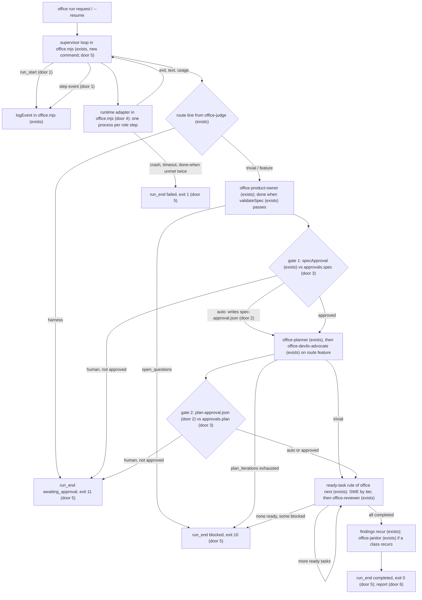
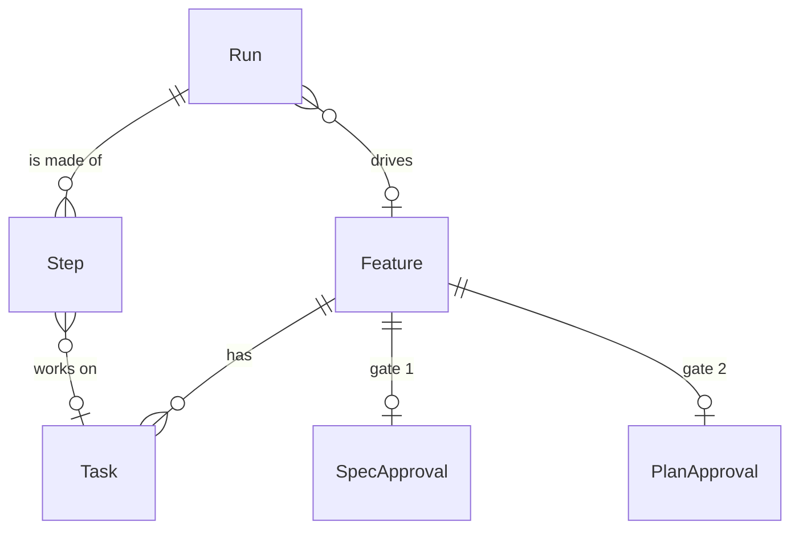

# Headless runs (RFC 0002)

## Problem

Nobody can run the pipeline without sitting at the keyboard. The loop that takes a request from
routing to a finished board lives in a prompt (`payload/commands/office.md`: "execute the board
task by task"), so how long it survives depends on one session's context and compliance. The gates
assume a person: the command says "stop and wait for the human", and `office spec approve` requires
`--by NAME` "after human confirmation", so an unattended run either stalls or an agent approves its
own spec and nothing records which. Gate 2 is not even a file, only a sentence in the Devil's
Advocate prompt. The `gates:` booleans in `config.yml` are loaded by the CLI and never read. And
the pipeline reports no token usage, while the roadmap's cost metric is split by role. `office next`
exits 1 for three different situations (blocked, in flight, complete) that a script cannot tell
apart. The RFC gives no figures; the cost is that the Phase 3 benchmark ("dozens of unattended
runs") and CI adoption are both impossible today.

When this ships, `office run "<request>"` drives a request to a completed board or a named stop
with no prompt, an approval records whether a human or a policy made it, the exit code says which
of five endings happened, and the run report shows tokens and cost per role.

## Flow

Reuses `validateSpec`, `specApproval`, `loadTasks`, the ready-task rule of `office next`,
`findings recur`, `logEvent`, the task-contract key list in `snapshot`, and the `spawnSync` pattern
`check` already uses; the supervisor adds no second scheduler, no second approval format and no
import.

The supervisor never holds `execution.lock` while a step runs, because the role inside the step
calls `claim`, `check`, `review`, `done`, which take it. It holds `.the-office/run.lock` (door 5)
for the whole run instead.

## Impact

| Front | What changes |
| --- | --- |
| domain | new term: `run` - one invocation of `office run`, identified by a run id; lives in `office.mjs` and in the event log |
| domain | new term: `step` - one runtime process for one role; the unit of token accounting |
| domain | new term: `approval mode` - `human` or `policy`, recorded on every approval |
| domain | new term: `plan approval` - Gate 2 as a file, `plan-approval.json`; `claim` does not read it, only `office run` does |
| domain | existing term: `event` meant "always carries `feature`" (event-log-stats AC 1); now `run_start` and the Judge's `step` may carry none - `office stats [feature]` and `office validate` branch on `feature` and `task` today and must keep ignoring these four events |
| domain | existing term: exit 1 of `office next` meant "no ready task, for any reason"; now 10, 12 or 3 - `payload/commands/office-next.md`, `payload/skills/office/SKILL.md`, `payload/skills/office-board/SKILL.md` and `README.md` state "exit 1" and are the only callers |
| domain | existing term: `gates:` booleans meant "enforced only by prompts"; now `office run` reads them as a fallback for `approvals:` |
| stored data | nothing to migrate: a `spec-approval.json` with no `mode` is read as `human`; a board with no `approvals:` or `run:` gets the defaults; a feature with no `plan-approval.json` still executes interactively |
| help text | the footer "Nothing here uses a model" becomes "Nothing here asks a model to decide anything" - `run` is the first command that starts one |
| role prompts | `office-product-owner.md` gains the headless rule (assume and record, or leave the question open and stop); roles are told not to call `spec approve` / `plan approve` |
| templates | `templates/config.yml.tmpl` and the inline config in `office init` gain `run:` and `approvals:` and stay byte-identical |
| board-ui | nothing: `board.rs` reads only `.the-office/features/*.md`; `plan-approval.json` sits beside `spec-approval.json`, which it already tolerates |
| release | a `feat!:` commit touching `payload/` and `templates/`; `scripts/release.mjs` maps `!` to a major bump, so the merge to `main` publishes `1.0.0` unless the release is forced with `--bump minor` |
| docs | RFC 0002 status and its `docs/rfcs/README.md` row become `Implemented`; its three open questions are answered in the RFC text |

## Relations

One-way constraints: a run and its steps exist only as lines of `events.jsonl`, so the report is
derivable from the log alone (door 1); an approval is valid only while its hash equals the current
hash of what it approved (door 2); at most one run per board at a time (door 5). No columns and no
types here.

## Surface

HTTP routes: none - the surface is CLI commands, so the "statuses" are exit codes. Each command
below owes a `Coverage` set row in `checks.md` whose members are its exit codes.

- `office run "<request>" [--feature <slug>] [--json] [--report <file>] [--step-timeout <minutes>] [--max-steps <n>]`
  (new) - in: request text, flags; out: one progress line per step on stderr, a summary or one
  JSON report on stdout (door 6); exit `0`, `1`, `2`, `10`, `11`
- `office run --resume [--feature <slug>] [...same flags]` (new) - in: the board as it stands; out:
  as above; exit `0`, `1`, `2`, `10`, `11`
- `office plan status <slug>` (new) - out: one JSON object `{id, hash, status, tasks}` with
  `status` one of `approved`, `stale`, `draft`; exit `0`, `1`
- `office plan approve <slug> --hash SHA --by NAME` (new) - out: the same object; writes
  `plan-approval.json` (door 2); exit `0`, `1`
- `office spec approve <slug> --hash SHA --by NAME` (changed) - additionally writes `mode` and
  appends an `approve` event; refuses `--by policy:*`; exit `0`, `1`
- `office next` (changed, breaking) - out: a task id on stdout, or the reason on stderr; exit `0`,
  `3`, `10`, `12`, and `1` for no board or an invalid one
- `office validate` (changed) - additionally rejects invalid `approvals:` and `run:` values; exit
  `0`, `1`
- runtime executable (consumed, door 4) - in: argv and cwd; out: one JSON object on stdout; exit
  `0` or non-zero

## Landing

| One-way door | Literal shape | Alternative rejected |
| --- | --- | --- |
| 1. Run events, committed | `{"v":1,"at":"...","event":"run_start","run":"r-20261125T120000123Z","outcome":"ok","request_hash":"<sha256 hex>","runtime":"claude"}` (plus `feature` when known; `request_hash` is `null` on `--resume`) · `{"v":1,"at":"...","event":"step","run":"r-...","feature":"x","role":"office-swe","task":"x/task-01","outcome":"ok","duration_ms":1234,"usage":{"input":0,"output":0,"cache_read":0,"cache_write":0,"cost_usd":0,"by_model":{"<model id>":{"input":0,"output":0,"cache_read":0,"cache_write":0,"cost_usd":0}}}}` with `outcome` one of `ok`, `unmet`, `crashed`, `timeout`, `task` only on task steps, `usage` `null` when the runtime returned none · `{"v":1,"at":"...","event":"approve","feature":"x","outcome":"ok","gate":"spec","by":"policy:auto","mode":"policy","hash":"<sha256 hex>"}` with `gate` one of `spec`, `plan`, `harness` · `{"v":1,"at":"...","event":"run_end","run":"r-...","feature":"x","route":"feature","outcome":"completed"}` with `outcome` one of `completed`, `blocked`, `awaiting_approval`, `failed` | storing the request text - a request may contain anything and the log is committed; parsing `stream-json` to attribute tokens to subagents - usage is reported per model for the session, not per subagent |
| 2. Approval files | `spec-approval.json` and `plan-approval.json`, both `{"hash":"<sha256 hex>","by":"<name>","at":"<ISO UTC>","mode":"human"}`; the plan hash is `sha256(JSON.stringify([[id, contract], ...]))` over the feature's tasks sorted by `id`, where `contract` holds the keys `snapshot` already attests: `id`, `title`, `tier`, `depends_on`, `scope`, `checks`, `dod`, `max_attempts`, `requirements`, `acceptance_criteria`, `verification_mode` | hashing the task files - `status`, `attempts` and notes change on every lifecycle command and would stale the approval at the first `claim`; a `--mode` flag on the command - any shell could then write `policy` or `human` at will |
| 3. Config keys | `run:` with `runtime: claude`, `permission_mode: acceptEdits`, `allowed_tools: []`; `approvals:` with `spec: human`, `plan: human`, `harness: human`; `approvals.<gate>` wins over the `gates:` boolean, and a `gates:` boolean set to `false` means `auto` only when `approvals.<gate>` is absent | extending `gates:` with string values - `true`/`false` is already written in every initialised board and RFC 0005 owns the merge; `harness: auto` - a harness change alters every contributor's workflow |
| 4. Runtime invocation contract | `<cmd> -p "<prompt>" --agent <role> --output-format json --permission-mode <mode> [--allowedTools <tool> ...]`, cwd the board root, `<cmd>` = `$OFFICE_RUNTIME_CMD` or `claude`; the adapter reads `is_error`, `result` and `modelUsage.<model>.{inputTokens,outputTokens,cacheReadInputTokens,cacheCreationInputTokens,costUSD}` from the one JSON object on stdout and nothing else; in `office.mjs`: `{ name, available(), invoke({ role, prompt, cwd, timeoutMs }) -> { exit, text, usage } }` | one `claude -p "/office <request>"` for the whole run - the loop stays in a prompt and usage is one number; reading top-level `usage` - it excludes subagent tokens and its key names are not documented, `modelUsage` includes them |
| 5. Exit codes and the run lock | `office run`: `0` completed, `1` failed, `2` usage, `10` blocked, `11` awaiting approval · `office next`: `0` task id, `3` complete or empty, `10` blocked, `12` in flight · `.the-office/run.lock` holding the pid, excluded by `isBoardState` | new codes only on `office run` and `office next --status` - keeps two ways to ask one question (user chose the break); reusing `execution.lock` for the run - every lifecycle command a role calls inside a step would be refused |
| 6. Run report keys | `{"run":"r-...","outcome":"completed","duration_ms":0,"tasks":{"completed":4,"blocked":0},"usage":{"by_role":{"office-planner":{"input":0,"output":0,"cache_read":0,"cache_write":0,"cost_usd":0}},"by_model":{"<model id>":{...same five}},"total":{...same five}}}` | a single total - the roadmap's cost metric is split by role |

- A CLI command that starts a model is a pattern this codebase does not have yet; doors 4 and 5 are
  its literal shape. `scripts/` was rejected as its home because `scripts/` is not installed and a
  target repository's CI is where the supervisor must run.
- Nothing else in this change is hard to reverse

## Criteria

### S1: `office run` drives a request to a finished board (P1)

One command takes a request and ends with every task `completed`, the CPU choosing each step.

**Acceptance Criteria**

1. WHEN `office run "<request>"` starts on a valid board THEN the CLI SHALL append one `run_start` event with a `run` id matching `^r-\d{8}T\d{9}Z$`, `request_hash` equal to the SHA-256 hex of the request text, `runtime` equal to `claude` and `outcome: "ok"`, and SHALL NOT write the request text to any file.
2. WHEN the supervisor runs a role step THEN the CLI SHALL start exactly one runtime process with the arguments `-p <prompt> --agent <role> --output-format json --permission-mode <run.permission_mode>`, with the board root as its working directory.
3. WHERE `run.allowed_tools` is a non-empty list, the CLI SHALL append `--allowedTools` followed by each entry as its own argument to every runtime invocation.
4. WHERE the environment variable `OFFICE_RUNTIME_CMD` is set, the CLI SHALL start that executable instead of `claude`.
5. WHEN the `office-judge` step returns THEN the CLI SHALL take the route from the single line `route: harness`, `route: trivial` or `route: feature` in its result text, and the feature slug from `--feature` when given and otherwise from the line `feature_slug: <slug>`.
6. WHEN the spec step runs THEN the CLI SHALL invoke `office-product-owner` with a prompt containing the request text and the feature slug, and SHALL treat the step as done only when `office spec validate <slug>` passes.
7. WHEN the route is `feature` and gate 1 is satisfied THEN the CLI SHALL invoke `office-planner` and then `office-devils-advocate`, repeating the pair at most `caps.plan_iterations` times, and SHALL treat the plan as converged only when `office spec validate <slug> --plan` and `office validate` pass and the Devil's Advocate result contains the line `verdict: approved`.
8. WHEN the route is `trivial` and gate 1 is satisfied THEN the CLI SHALL invoke `office-planner` once, SHALL require `office spec validate <slug> --plan` and `office validate` to pass, and SHALL invoke neither `office-devils-advocate` nor gate 2.
9. IF the plan has not converged after `caps.plan_iterations` Planner and Devil's Advocate pairs THEN the CLI SHALL end the run with `run_end` outcome `blocked`, print the reason, and exit 10.
10. WHILE the run's feature has a `pending` task whose dependencies are all `completed`, the CLI SHALL take the one with the lowest `task_no` and invoke `office-swe-fast` for tier `fast`, `office-swe` for `standard` and `office-swe-deep` for `deep`, treating that step as done only when the task's status is `review`.
11. WHEN a task reaches `review` THEN the CLI SHALL invoke `office-reviewer` and treat that step as done only when the task's status is `completed`, `in-progress` or `blocked`.
12. WHEN the Reviewer leaves a task `in-progress` THEN the CLI SHALL invoke the task's SWE again, up to `caps.review_iterations` SWE and Reviewer pairs per task per run.
13. IF a task is still `in-progress` after `caps.review_iterations` pairs THEN the CLI SHALL block it with the reason `review_iterations exhausted`, producing the same task-file change and `block` event as `office block`.
14. WHEN a task ends `blocked` THEN the CLI SHALL continue with the next ready task of the feature, if any.
15. WHEN every task of the feature is `completed` and `office findings recur` exits 0 THEN the CLI SHALL invoke `office-janitor` exactly once before ending the run.
16. WHEN every task of the feature is `completed` THEN the CLI SHALL append `run_end` with outcome `completed` and exit 0.
17. WHEN a runtime process ends THEN the CLI SHALL append exactly one `step` event with `run`, `role`, `outcome`, an integer `duration_ms` >= 0, `usage`, `feature` once the slug is known, and `task` equal to the task id on SWE and Reviewer steps only.
18. IF a step returns with exit 0 and its done-when condition unmet THEN the CLI SHALL record the step with outcome `unmet` and invoke the same role once more.
19. IF the second invocation of a step also returns with its done-when condition unmet THEN the CLI SHALL append `run_end` with outcome `failed` and exit 1.
20. IF a runtime process exits non-zero, prints something other than one JSON object, returns `is_error: true`, or returns no `modelUsage` object THEN the CLI SHALL record the step with outcome `crashed`, name the missing or failing part on stderr, append `run_end` with outcome `failed` and exit 1 without retrying.
21. IF a runtime process runs longer than `--step-timeout` minutes (default `30`) THEN the CLI SHALL kill it, record the step with outcome `timeout`, append `run_end` with outcome `failed` and exit 1.
22. IF the number of runtime invocations in one run reaches `--max-steps` (default `100`) THEN the CLI SHALL append `run_end` with outcome `failed` and exit 1 without starting another.
23. IF the runtime executable cannot be started THEN the CLI SHALL exit 1 naming the executable and SHALL append no event.
24. IF `office validate` fails on the board when the run starts THEN the CLI SHALL exit 1 and SHALL append no event.
25. IF `.the-office/run.lock` exists when `office run` starts THEN the CLI SHALL exit 1 naming the lock, SHALL append no event and SHALL leave the lock in place.
26. WHILE a run is in progress, the CLI SHALL keep `.the-office/run.lock` present, SHALL NOT hold `.the-office/execution.lock` during a step, and SHALL treat `run.lock` as board state so that `office claim` and `office review` do not see a dirty tree; WHEN the run ends with any outcome THEN the CLI SHALL remove `run.lock`.
27. IF `office run` is called with neither a request nor `--resume`, with both, with an unknown flag, with a `--step-timeout` or `--max-steps` that is not a positive integer, with an invalid `--feature` slug, or with a request and a `--feature` that already exists THEN the CLI SHALL print the usage on stderr, exit 2 and append no event.

**Independent test:** in a temp Git repo with the `good` board layout, set `OFFICE_RUNTIME_CMD` to the stub under `tests/`, set both approvals to `auto`, run `office run "add a greeting" --json`, expect exit 0 and every task `completed`.

### S2: gates are a policy the supervisor applies and records (P1)

A gate is satisfied by a file whose hash matches, written by a human or by a policy, and the log says which.

**Acceptance Criteria**

28. WHILE `config.yml` has no `approvals:` key and every `gates:` boolean is `true` or absent, the CLI SHALL apply `human` to the `spec`, `plan` and `harness` gates.
29. WHILE `approvals.spec` is absent and `gates.after_po_clarification` is `false`, the CLI SHALL apply `auto` to gate 1, and likewise `approvals.plan` with `gates.after_plan_converges` for gate 2; WHERE `approvals.<gate>` is present the CLI SHALL apply it regardless of `gates:`.
30. WHEN the run reaches a gate whose approval file has a `hash` equal to the current hash THEN the CLI SHALL proceed and SHALL NOT rewrite the file or append an `approve` event.
31. IF the run reaches gate 1 with policy `human` and the spec approval is missing or stale THEN the CLI SHALL print the exact `office spec approve <slug> --hash <hash> --by NAME` command, append `run_end` with outcome `awaiting_approval` and exit 11.
32. IF the run reaches gate 2 with policy `human` and the plan approval is missing or stale THEN the CLI SHALL print the exact `office plan approve <slug> --hash <hash> --by NAME` command, append `run_end` with outcome `awaiting_approval` and exit 11.
33. WHEN the run reaches gate 1 with policy `auto` and the spec approval is missing or stale THEN the CLI SHALL write `spec-approval.json` with `by: "policy:auto"` and `mode: "policy"` and append an `approve` event with `gate: "spec"`, `by: "policy:auto"`, `mode: "policy"` and `hash` equal to the spec hash.
34. WHEN the run reaches gate 2 with policy `auto` and the plan approval is missing or stale THEN the CLI SHALL write `plan-approval.json` with `by: "policy:auto"` and `mode: "policy"` and append an `approve` event with `gate: "plan"` and `hash` equal to the plan hash.
35. IF the spec has a non-empty `open_questions` list when the spec step is done or when a run resumes THEN the CLI SHALL print each question, write no approval, append `run_end` with outcome `blocked` and exit 10.
36. WHEN the Judge routes a request to `harness` THEN the CLI SHALL invoke no further role, print that a harness change is approved interactively through `/office`, append `run_end` with outcome `awaiting_approval` and exit 11.
37. WHEN `office spec approve` succeeds from the command line THEN the CLI SHALL write `mode: "human"` to `spec-approval.json` and append an `approve` event with `gate: "spec"`, `mode: "human"`, `by` and `hash` equal to the values written.
38. WHEN `office plan approve <slug> --hash SHA --by NAME` runs with `SHA` equal to the current plan hash, a non-empty `NAME`, and a plan for which `office spec validate <slug> --plan` passes THEN the CLI SHALL write `plan-approval.json` with `hash`, `by`, `at` and `mode: "human"`, append an `approve` event with `gate: "plan"` and `mode: "human"`, and exit 0.
39. IF `office plan approve` is given a hash different from the current plan hash, an empty `--by`, or a plan that does not validate THEN the CLI SHALL exit 1 and write nothing.
40. IF `--by` begins with `policy:` on `office spec approve` or `office plan approve` THEN the CLI SHALL exit 1 and write nothing.
41. WHEN `office plan status <slug>` runs THEN the CLI SHALL print one JSON object with `id`, `hash`, `tasks` equal to the number of tasks, and `status` equal to `approved` when `plan-approval.json` carries the current hash, `stale` when it carries another, and `draft` when it is absent.
42. The plan hash SHALL be unchanged by a change to a task's `status`, `attempts`, `base_commit`, `branch`, `commit` or body, and SHALL change when any of `id`, `title`, `tier`, `depends_on`, `scope`, `checks`, `dod`, `max_attempts`, `requirements`, `acceptance_criteria` or `verification_mode` changes on any task, or when a task is added or removed.
43. IF `approvals.harness` is present and not `human`, or `approvals.spec` or `approvals.plan` is present and neither `human` nor `auto`, or `run.runtime` is present and not `claude`, or `run.allowed_tools` is present and not a list THEN `office validate` SHALL exit 1 naming the key and its value.
44. The file `payload/agents/office-product-owner.md` SHALL state that in a headless run the Product Owner records a reasonable assumption under `Assumptions` or leaves the question in `open_questions` and stops, and that it never calls `office spec approve`.

**Independent test:** run the stub with `approvals.spec: human`; expect exit 11 and the printed approve command; run that command, then `office run --resume`, expect the run to continue past gate 1.

### S3: `--resume` continues from the board (P1)

After a stop, one command continues from where the board stands, with no request.

**Acceptance Criteria**

45. WHEN `office run --resume` starts THEN the CLI SHALL take the feature from `--feature` when given and otherwise from the last `run_end` event that carries a `feature`, and the route from the last `run_end` event of that feature, defaulting to `feature` when there is none.
46. IF `office run --resume` can resolve no feature, or the feature directory does not exist THEN the CLI SHALL exit 2 and append no event.
47. WHEN a run resumes THEN the CLI SHALL append `run_start` with a new `run` id, `request_hash: null` and the feature, and SHALL invoke neither `office-judge` nor `office-product-owner`.
48. IF a run resumes on a feature whose spec fails `office spec validate <slug>` THEN the CLI SHALL append `run_end` with outcome `failed` and exit 1.
49. WHEN a run resumes THEN the CLI SHALL continue at the first unmet condition in the order gate 1, plan (only when the feature has no tasks), gate 2 (route `feature` only), tasks, steer.
50. WHEN a run resumes and a task of the feature is `in-progress` THEN the CLI SHALL invoke that task's SWE before any other task; WHEN one is `review` THEN the CLI SHALL invoke `office-reviewer` for it first.
51. WHEN `office run --resume` follows an exit 11 whose gate has since been approved with the current hash THEN the CLI SHALL drive the board to completion and exit 0.

**Independent test:** `office run` to exit 11 at gate 2 with the stub, `office plan approve`, then `office run --resume`; expect exit 0.

### S4: the ending and the cost are readable by a script (P1)

Five endings have five exit codes, and the report says what each role cost.

**Acceptance Criteria**

52. The CLI SHALL end `office run` with exit `0` when every task of the feature is `completed`, `10` when no task is ready and at least one is `blocked` or the spec has open questions or the plan did not converge, `11` when a gate with policy `human` is unapproved or the route is `harness`, `2` on a usage error, and `1` otherwise.
53. WHEN `office run` ends after appending `run_start` THEN the CLI SHALL append exactly one `run_end` event for that `run` with `outcome` matching the exit code (`completed` 0, `failed` 1, `blocked` 10, `awaiting_approval` 11), `feature` when the slug is known and `route` when it is known.
54. WHEN `office run --json` ends after appending `run_start` THEN the CLI SHALL print exactly one JSON object on stdout with the keys `run`, `outcome`, `duration_ms`, `tasks` and `usage`, and SHALL print step progress only on stderr.
55. WHERE `--report <file>` is given, the CLI SHALL write the same JSON object to that file for every outcome that appended `run_start`.
56. The CLI SHALL compute a step's `usage` from the runtime's `modelUsage` map as `input` = sum of `inputTokens`, `output` = sum of `outputTokens`, `cache_read` = sum of `cacheReadInputTokens`, `cache_write` = sum of `cacheCreationInputTokens`, `cost_usd` = sum of `costUSD`, with `by_model` holding the same five keys per model id.
57. The report's `usage.by_role` SHALL hold, for every role with at least one `step` event of this run, the sum of that role's step usages; `usage.by_model` SHALL hold the sum per model id; `usage.total` SHALL hold the sum over all steps; steps whose `usage` is `null` SHALL add nothing.
58. The report's `tasks` SHALL hold `completed` and `blocked` equal to the number of the feature's tasks in each status when the run ends, both `0` when no feature is known.
59. The report SHALL be computable from the `run_start`, `step` and `run_end` events of its `run` id plus the board, with no state kept elsewhere.
60. WHEN `office run` ends without `--json` THEN the CLI SHALL print on stdout the outcome and one row per role with its tokens and cost.
61. WHEN `office next` runs THEN the CLI SHALL exit `0` printing the task id when a task is ready, `12` when none is ready and a task is `in-progress` or `review`, `10` when none is ready, none is in flight and a task is `blocked`, and `3` when the board is complete or empty.
62. WHILE `events.jsonl` contains `run_start`, `step`, `approve` and `run_end` lines, `office stats --json` SHALL print the same `metrics` and `excluded` as for the log without those lines, and `office validate` SHALL exit 0.
63. WHEN `office help` runs THEN the CLI SHALL list `run`, `plan approve|status` and the four exit codes of `next`, and its footer SHALL read `Nothing here asks a model to decide anything.` and SHALL NOT contain `Nothing here uses a model`.
64. The file `payload/bin/office.mjs` SHALL import only `node:` modules.
65. The inline config written by `office init` SHALL contain `run:` with `runtime: claude`, `permission_mode: acceptEdits` and `allowed_tools: []`, and `approvals:` with `spec: human`, `plan: human` and `harness: human`, and SHALL stay byte-identical to `templates/config.yml.tmpl` after `{{VERSION}}` substitution.
66. No file under `payload/` and no `README.md` line SHALL describe `office next` as exiting 1 when no task is ready; `payload/commands/office-next.md` SHALL name the codes `3`, `10` and `12`.

**Independent test:** run the stub scripted for each ending (completed, blocked task, human gate, crashed step, timed-out step) and compare `$?` and the `--json` report.

### S5: the headless path is documented and has a real-runtime job (P2)

A person can find how to run it in CI, and one manual job exercises the real runtime.

**Acceptance Criteria**

67. The `README.md` SHALL have a headless section that shows `office run`, the five exit codes, the `approvals:` and `run:` keys, and a sentence recommending a container placed directly beside every example that sets a `permission_mode` other than `acceptEdits` or `default`.
68. The repository SHALL have a workflow job triggered only by `workflow_dispatch` that installs the-office into a fixture repository, runs `office run` with a fixture request against the real runtime with both approvals `auto`, fails unless the exit code is 0, and fails unless the report's `usage.by_role` has an entry for every role with a `step` event.
69. WHEN `tests/run.sh` runs THEN it SHALL run the headless tests against the stub runtime and SHALL NOT start the real runtime.
70. The `payload/skills/office/SKILL.md` SHALL describe `office run`, its exit codes and the approval policy.

**Independent test:** read the README section; trigger the job by hand once the secret exists.

## Out of scope

| Excluded | Why |
| --- | --- |
| adapters for runtimes other than `claude` | RFC 0006 adds them behind the same interface |
| merging `gates:` into `approvals:` | RFC 0005 schema migration; until then `approvals:` wins |
| `office stats` reading `step` usage or using `run_start` as the lead-time left edge | the RFC only requires the report be rebuildable from the log; changing stats' frozen JSON keys is a separate door |
| headless harness changes (invoking `office-manager`, a command that approves gate 3) | RFC: no unattended run installs a harness change |
| the supervisor committing on the SWE's behalf | RFC open question; see Assumptions |
| making `claim` require a plan approval | would refuse every existing board and every interactive run that never wrote one |
| parallel task execution | the lifecycle is sequential by design (`requireIdle`) |
| a spending cap (`--max-budget-usd`) or `--max-turns` passthrough | not in the RFC; `--max-steps` and `--step-timeout` are its bounds |
| removing the interactive `/office` command | RFC: it stays, as the same pipeline with a model as the loop |

## Assumptions

| Assumption | Chosen default | Rationale | Confirmed? |
| --- | --- | --- | --- |
| RFC open question: is changing `office next`'s exit codes worth a breaking release? | Yes, `feat!:` | the only callers are prompts shipped in the same payload | y |
| RFC open question: does the `trivial` route need plan approval? | No - Planner writes the one task, no Devil's Advocate, no gate 2 | matches the interactive trivial path | y |
| RFC open question: should the supervisor commit on the SWE's behalf? | No | `review` already refuses a dirty tree, so an uncommitted SWE step is `unmet`, retried once, then the run fails loudly; a supervisor that writes commits is additive later and hard to take back | n |
| what a `harness` route does headless | stops at exit 11 right after the Judge, without invoking `office-manager` | RFC: "always ends at awaiting approval"; no command records a harness approval, so `gate: "harness"` is reserved in the event shape and never emitted here | n |
| plan that does not converge within `caps.plan_iterations` | exit 10 (`blocked`), not 1 | the config comment says exceeding a cap "escalates to a human", which is what 10 means; the RFC's table lists only blocked tasks and open questions under 10 | n |
| who blocks a task when `caps.review_iterations` is exhausted | the supervisor, in code | today a prompt (`office-next.md`) tells the model to; a count is a CPU's job | n |
| defaults for `--step-timeout` and `--max-steps` | 30 minutes and 100 invocations | the RFC names the flags and no values; both are flags, so the default is reversible | n |
| a crashed or timed-out step | fails the run without retry; only a clean return with done-when unmet is retried | RFC: "retried once" is said of a step "that returns"; a crash is listed under exit 1 | n |
| run id | `r-` plus the UTC start time to the millisecond | one run per board at a time (`run.lock`), so the timestamp is unique within a board | n |
| work in flight in another feature when a run starts | not checked up front; the first `claim` is refused by `requireIdle`, the step is `unmet` twice and the run fails with exit 1 | the board is sequential across features today; a dedicated message is reversible polish | n |
| a stale `run.lock` after a killed run | the next run refuses and names the file; a human removes it | same rule as `execution.lock`: never silently steal a live run | n |
| reading the Judge's route and the Devil's Advocate's verdict from result text | accepted for these two steps only | both roles already end with a fixed line (`route:`, `verdict:`) and neither leaves a board fact a command could check; every other step is checked against the board | n |
| denying `spec approve` / `plan approve` to roles | prompts forbid it and `allowed_tools` is passed through; the CLI refuses `--by policy:*` | RFC risk: "narrows the hole and does not close it"; `mode` and `by` are in the log for every approval | n |
| RFC status is `Draft` | the request to plan and build is the acceptance; status goes to `Implemented` when the Verifier passes | same rule as RFC 0001 | n |
| profile | `light` (no declaration in the repo) | skill default; see the note to the reviewer about `standard` | n |

| # | Kind | Question | Until answered |
| --- | --- | --- | --- |
| 1 | blocks go-live | Which repository secret holds the API key for the `workflow_dispatch` job, and who pays for its runs? | AC 68 is written and its file exists, but RFC exit criteria 1 and 2 ("runs to completion in CI", "report shows token usage for every role") are proven only when someone triggers it |
| 2 | open | The JSON printed by `claude -p --output-format json` is documented only through the SDK's `SDKResultMessage` and `ModelUsage` types, not field by field for the CLI | door 4 reads exactly three fields and AC 20 fails loudly when one is missing; the stub encodes the documented shape, and only question 1's job confirms the real one |

## Observable

| Surface | Decision | Landing |
| --- | --- | --- |
| command `office run` | output format and verbosity | AC 54, AC 60 |
| command `office run` | every flag and its default | AC 21, AC 22, AC 27, AC 55, AC 45 |
| command `office run` | exit codes | AC 52 |
| command `office run` | what it prints when it fails halfway | AC 20, AC 53, AC 55 |
| command `office plan status` / `approve` | output, exit codes | AC 38, AC 39, AC 41 |
| command `office plan approve` | fails halfway | existing - the write-to-tmp-then-rename pattern `spec approve` uses |
| command `office spec approve` | output, exit codes | AC 37, AC 40; stdout unchanged |
| command `office next` | output and exit codes | AC 61 |
| command `office validate` | new config errors | AC 43 |
| command `office init` | what it writes | AC 65 |
| runtime executable (consumed) | argv, response shape, error shape | AC 2, AC 3, AC 4, AC 20, AC 56 |
| runtime executable (consumed) | who may call it, versioning, rate limits | n/a - the CLI is the caller; the runtime's own auth and rate limits surface as a non-zero exit or `is_error`, both AC 20 |
| document `office help` | lists the new commands, footer | AC 63 |
| document README headless section | structure, what the reader does next | AC 67 |
| documents `office-next.md`, `office` and `office-board` skills | exit codes stated | AC 66, AC 70 |
| document `office-product-owner.md` | headless rule | AC 44 |
| collection `events.jsonl` | ordering, duplicates, the line that does not fit | AC 17, AC 53 (one per step, one `run_end` per run), AC 62 (older readers ignore the new events) |
| collection run report `usage` | grouping criterion, naming, the step with no usage | AC 57 |

## Sources

- `docs/rfcs/0002-headless.md` - steps, approval policy, events, exit codes, report shape, test plan, exit criteria
- `docs/ROADMAP.md` Phase 2 - the four deliverables and the exit criterion
- Claude Code CLI reference and Agent SDK TypeScript types (`code.claude.com/docs/en/cli-reference`, `.../headless`, `.../agent-sdk/typescript`) - `--agent`, `--permission-mode`, `--allowedTools`, and the `modelUsage` field names door 4 binds to
